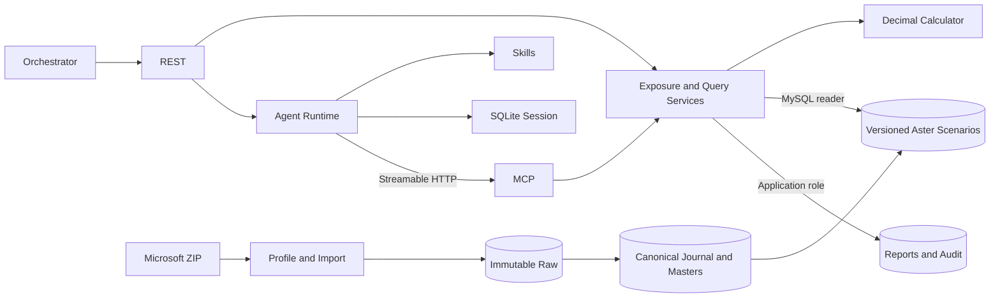

# ERP Agent 架構

REST 與 MCP 使用同一應用服務。SQLAlchemy Core 透過 MySQL InnoDB 的 REPEATABLE READ 交易取得情境版本、授權 AR/AP 與付款配置。報表、分組、來源參與記錄與分析稽核在同一交易提交。tenant + idempotency key 的唯一索引處理重送競爭。

Runtime 於請求中保留工具執行紀錄與可確認的 run ID。SQLite session 只在 tenant、actor type、actor ID、session ID 的組合下保存最後一個報表參照。持久化數字與稽核在 MySQL，業務規則由 schema registry 與兩個可信 Skill 提供。
